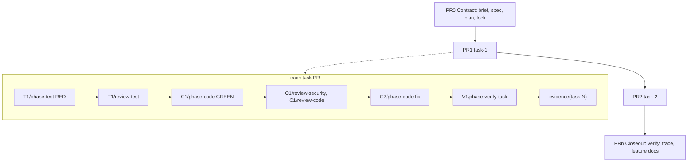

# Spec: ASDLC-1 — Evidence stack: stacked PRs with typed red/green/review commits, locked contract and feature knowledge

*Date: 2026-10-29. **Authoritative contract:** `spec.json` in this directory (schema `spec-schema.json`). This file is generated from the JSON — edit the JSON, not this file.*

Stack of PRs and the commits in each task PR



## Problem Statement

ACCORD's agentic workflow suits small changes. For a new feature or greenfield solution, engineers cannot gain confidence in the code's lineage or in the process that produced it. One branch and one PR carry many concerns, and the red and green test runs, adversarial review rounds and fix rounds live in gitignored .tasks/, so git holds no evidence of them. Reviewers read one large diff plus verify.md. There is no capability-keyed record of what the system does, so new work cannot be checked against older features.

## Proposed Solution

Make git history the evidence log and keep a durable evidence asset per PR. Deliver nine features, in dependency order, each a stack of task PRs behind switches that default to off (stack.enabled, knowledge.enabled, stack.commits): commit-evidence (commit grammar, Accord trailer, orchestrator-only per-phase commits, accord evidence timeline); evidence-asset (final evidence commit and asset); security-gate (review-security gates in the C loop); contract-lock (PR0, contract.lock.json, contract-amend); stack-compute (plan fields, computeStack, gh StackProvider, stack map and PR brief); tree-state (committed state for stateless resume, closeout); trunk-hardening (open-PR depth cap, flags, bottom-up merge, accord/evidence check, overrun decision); feature-knowledge (capability-keyed docs, impact analysis, drift check); ci-driven-mode (CI builds PR0 and task PRs from brief and spec). One PR covers one concern, stays small and safe to merge to main, and oversized tasks are re-planned, never split by the harness. Terms: a work item is the ticket-keyed change (ASDLC-1); a feature is a slug-keyed unit of system behaviour with a living doc in docs/features, delivered by N tasks and composed through depends_on; a task is one plan unit and one PR; phase means only a harness agent step (phase-test, phase-code). Design: docs/plans/evidence-stack-plan.md; brief: docs/dev/ASDLC-1/brief.md.

## Acceptance Criteria

### AC-1 (MUST, scenario)

Given stack.commits is "phase" (default "task"; independent of stack.enabled) and a task runs a test round
When phase-test, review-test, phase-code, review-security, review-code and phase-verify-task each return
Then the orchestrator makes one commit per phase completion, each subject names its ref (T1/phase-test, C1/review-security, V1/phase-verify-task), agents never commit, and each review commit holds its findings before the next phase starts

### AC-2 (MUST, scenario)

Given a commit built by commit-grammar
When the Accord trailer is parsed and validated
Then it is one line of key=value pairs, required keys are present, counts equal the staged findings and tests, unknown x_ keys are ignored, and the documented awk extraction over git log returns the same values

### AC-3 (MUST, scenario)

Given a review commit stages a file outside docs/dev/<ID>/reviews/** and docs/dev/<ID>/state/**, or a code-loop commit stages a test file
When the orchestrator runs the commit guard
Then the out-of-scope path is not committed, a stack.guard.rejected log event is emitted, and a test edit respawns phase-test

### AC-4 (MUST, scenario)

Given a branch with typed phase commits
When the user runs accord evidence <ID>, with --format tsv or without
Then a timeline is rendered from git trailers only (ref, outcome, counts, tokens, cost) and the tsv columns match the documented awk extraction

### AC-5 (MUST, scenario)

Given a task PR whose phases are done
When the final commit is made
Then it is evidence(task-<N>) (evidence(task-<N>,<M>) for a merged PR), writes docs/dev/<ID>/evidence/task-<N>.{md,json} per task from commits and trailers (red and green excerpts, findings, review-to-fix patches, planned vs actual size), and deletes docs/dev/<ID>/state/task-<N>/
And the asset still exists after a squash merge

### AC-6 (MUST, constraint)

Every AC or TC reference outside spec.json (evidence asset .md and .json, trace.json, the PR brief and the stack map) MUST be work-item-qualified as <work_item_id>/AC-<n>, never a bare AC-<n>, so it resolves once many work items exist; the Accord trailer ac= key may stay bare because the same trailer carries id=

### AC-7 (MUST, scenario)

Given orchestration.review_loop.review_security.severity_gate is unset and stack.enabled is false
When review-security returns critical, warning or suggestion findings
Then they stay advisory exactly as today and no round is gated

### AC-8 (MUST, scenario)

Given stack.enabled is true and severity_gate is unset (effective warn), or severity_gate is set to block, warn or none
When review-security returns open findings in a C round
Then findings at or above the gate severity gate the round (block: critical; warn: critical and warning; none: any), suggestions stay advisory under warn and block, the next C round phase-code fixes security and code findings together, review-code re-reviews it, and at the code_review retry cap the task blocks for a human

### AC-9 (MUST, scenario)

Given implement or greenfield work with stack.enabled
When the contract is approved
Then PR0 contains docs/dev/<ID>/{brief.md,spec.json,plan.json}, state/work-item.json and contract.lock.json with sha256 of each of brief.md, spec.json and plan.json (state/work-item.json is not locked because closeout deletes it) plus the sha of the commit preceding the lock commit, and the lock commit is tagged accord/<ID>/contract (the tag is informational; the lock file is the durable record and survives squash)
And an edit to a locked file without a contract-amend fails the hook and the CI check, while a contract-amend PR with diff, reason and affected ACs passes and marks downstream tasks stale

### AC-10 (MUST, scenario)

Given a plan with est_lines, concern, depends_on, flag and kind on each task
When computeStack runs twice with the same config
Then the output is byte-identical, adjacent same-concern tasks below min_pr_lines merge within the budget, a task above max_pr_lines or max_files is flagged for re-plan and never split, independent tasks are siblings, and PR count is 2 plus packed task groups

### AC-11 (MUST, scenario)

Given stack.provider is "gh" behind the StackProvider port
When accord stack submit runs for a computed stack
Then PRs are created or updated with a stack map comment and a generated PR brief (contract link first, ACs and proving tests, process summary, reading order), one accord/evidence status check replaces bot comments, accord stack <ID> prints the computed stack table, accord stack sync refreshes it from provider state, accord stack report renders the per-PR roll-up from trailers (rows per loop; rounds, findings, tests, tokens, cost), dev_stack_* MCP tools return the same results, and an unsupported provider fails with a clear error

### AC-12 (MUST, scenario)

Given stack.state.persist is "tree" and stack.state.redact is true
When the orchestrator makes any typed commit except the final evidence(task-<N>) commit, which deletes the directory
Then docs/dev/<ID>/state/task-<N>/ in the same commit holds STATE.md (the accord trace rendering) and a redacted task.json valid against task-schema.json with in_flight null, test output is redacted (secrets and tokens, environment values, home-directory absolute paths, prompts and transcripts) and capped at stack.state.max_bytes, raw return packets are never staged, and with stack.state.redact false no state is committed (tree persistence requires redaction)

### AC-13 (MUST, scenario)

Given a fresh clone checked out at any typed commit of a task branch before its evidence commit (after it the task is done and has nothing to resume)
When accord resumes with no local .tasks/
Then state is rebuilt from docs/dev/<ID>/state/ and the other artifacts, the next ref is the same as in the original run, findings are read from the tree with no review re-run, and the evidence asset regenerated from the last pre-deletion commit equals the committed asset

### AC-14 (MUST, scenario)

Given the closeout commit has deleted the rest of docs/dev/<ID>/state/
When the accord/evidence check runs on a PR to main
Then it passes while the work item is open (state/work-item.json from PR0 and in-flight task state are allowed on PR heads before their evidence commit), and it fails if docs/dev/<ID>/state/task-* remains at a PR head after its evidence commit, or if any docs/dev/*/state/ exists on main after closeout

### AC-15 (MUST, scenario)

Given all task PRs are done
When the closeout commit is made
Then verify.*, trace.* and workflow-cost.* are built, the remaining docs/dev/<ID>/state/ (including work-item.json) is deleted after they are built, and the closeout PR is the last PR of the stack

### AC-16 (MUST, scenario)

Given a task whose actual changed lines (net production plus test lines, excluding generated files, lockfiles, state, reviews and evidence) exceed overrun_factor times est_lines after GREEN
When the harness measures the diff
Then a decisions[] entry is raised with the options to re-plan through contract-amend or accept with a reason, a stack.overrun.detected log event is emitted, and planned vs actual size (production and test lines separately) is recorded in trace.json

### AC-17 (MUST, scenario)

Given a depends_on chain longer than stack.sizing.max_depth and require_flag true
When the stack is submitted
Then at most max_depth PRs of the chain are open, the next opens after its base merges, every non-final task PR leaves main green with the feature unreachable behind a flag, and only the last task flips the flag
And PRs merge bottom-up: after a base PR merges, the next PR in the chain is retargeted to main by merging main into it (no rebase, no force-push, so evidence stays append-only). When the base PR was squash-merged, main holds its changes as one new commit while the child branch still holds the original base commits, so a file the child changed after the base added it is an add/add conflict on a plain merge. Resolution rule: for each conflicted path, if main's content equals the base PR head's content the child's version is kept (the child's changes sit on top of identical content); any other conflict stops the advance and raises a decisions[] entry, never a silent resolution.

### AC-18 (MUST, scenario)

Given feature docs under knowledge.root with OKF frontmatter
When validate:features and the index generator run
Then index.md and index.json are regenerated, links, anchors and test references resolve, every feature AC has a test, and a feature above max_acs_per_feature is reported

### AC-19 (MUST, scenario)

Given knowledge.enabled and plan.files that intersect a feature's anchors.code
When the contract (PR0) is built
Then an Impacted features table lists the feature with its relation (new, extends, modifies, deprecates, depends_on), depends_on and related traversal is included, and overlaps or contradicting ACs become decisions[]

### AC-20 (MUST, scenario)

Given a change that touches files anchored by a feature
When closeout runs
Then the feature doc is updated with the AC delta and a changes[] entry linking the work item, PR, evidence and contract sha, the mapping from each work-item AC (<ID>/AC-<n>) to its feature AC id is recorded, the feature doc acs[].tests lists the tests that carry the qualified ids, and and drift_check warn reports or block fails when the doc was neither updated nor declared unchanged

### AC-21 (MUST, scenario)

Given an index of features
When the user runs accord feature find <query|path> or accord feature impact <ID>
Then results come from index.json (index, then feature, then change record, then evidence) and the same logic is available as dev_feature_* MCP tools

### AC-22 (MUST, scenario)

Given knowledge.enabled and impacted feature docs for a change
When review agents are briefed and when CI runs on any PR (not only harness PRs)
Then review agents receive the impacted feature docs as invariants and a regression against an existing feature AC is a finding, and the same drift check runs in CI so a manual edit cannot invalidate a feature doc unnoticed

### AC-23 (MUST, scenario)

Given a new branch accord/<ID>/* that adds only docs/dev/<ID>/brief.md and spec.json
When CI runs
Then it commits plan.json and the proposed stack table to PR0 and stops at the human gate, with no local session

### AC-24 (MUST, scenario)

Given PR0 is merged and a CI job is interrupted at any typed commit
When the job runs again
Then it resumes idempotently from the last typed commit, one concurrency lock per <ID> prevents parallel runs, gates (PR0 approval, blocked task, closeout) are signalled by PR comments or commits, and the per-work-item cost cap (stack.ci.cost_cap_usd, default unset = no cap) stops the run and sends an alert (stack.ci.alert log event) when exceeded; a failed gate raises the same alert; alerts are delivered as a PR comment on the work item PR through the CI platform with the existing push token, so no separate credential is needed

### AC-25 (MUST, constraint)

CI-driven mode treat ACCORD_CI_PUSH_TOKEN (a GitHub App token or PAT) as a required env var with no default, and MUST fail to start, before any step, when it is absent, because commits made with GITHUB_TOKEN do not trigger workflows

### AC-26 (MUST, property)

With stack.enabled and knowledge.enabled unset or false and stack.commits unset or "task", the existing single-branch, single-PR flow, per-task commits (orchestration.commit.on_task_done), and review-security advisory behaviour are unchanged; existing docs/dev/<ID>/ paths, rehydrate, trace and CI keep working; quick_fix keeps one branch and one PR

### AC-27 (MUST, constraint)

Evidence commits are append-only: the harness MUST NOT amend or force-push them, and a failed round adds commits and never rewrites them

### AC-28 (MUST, architectural)

Orchestration and domain logic (commit grammar, computeStack, evidence, state, feature knowledge) MUST live in packages/accord-core; pi-accord, accord-cli and accord-mcp stay thin adapters and Pi APIs never enter accord-core *(enforcement: check:types, check:bundle and an import-boundary test in packages/accord-core/tests that fails if accord-core imports a Pi package; reviewed by review-code)*

### AC-29 (MUST, architectural)

The telemetry events stack.commit.created, stack.guard.rejected, stack.state.snapshot and stack.overrun.detected MUST be emitted through the shared accord-core logger (logging.ts) at, respectively, the orchestrator commit function, the commit guard rejection path, the state snapshot writer and the overrun measurement *(enforcement: Unit tests per call site assert the event name, level and field names; review-code Observability check against this AC)*

### AC-30 (MUST, architectural)

New agents, schemas and config keys MUST stay aligned across manifest.json, registry.ts and schemas/ (plan fields est_lines, concern, depends_on, flag, kind; spec features[]; stack and knowledge keys) *(enforcement: bun run validate:schemas and bun run validate:assets fail on misalignment)*

### AC-31 (MUST, architectural)

Each feature MUST update the affected okf/ concepts and append a dated entry to okf/log.md; procedure text in files marked style: ste follows ASD-STE100; changes under packages/accord-ci/ also update docs/ci/pre-merge-smoke.md *(enforcement: bun run validate:okf, bun run validate:ste, bun run check:biome and review-code checklist)*

## Scope

### In

- Feature commit-evidence (depends_on: none; AC-1 to AC-4): commit grammar (commit/commit-grammar.ts), orchestrator-only per-phase commits behind stack.commits: phase, accord evidence timeline
- Feature evidence-asset (depends_on: commit-evidence; AC-5 to AC-6): final evidence(task-N) commit writing docs/dev/<ID>/evidence/task-<N>.{md,json}
- Feature security-gate (depends_on: none; AC-7 to AC-8): review-security gating inside the C loop via review_loop.review_security.severity_gate
- Feature contract-lock (depends_on: none; AC-9): contract PR0, contract.lock.json, lock guard (hook and CI), contract-amend
- Feature stack-compute (depends_on: contract-lock, evidence-asset; AC-10 to AC-11): phase-plan agent prompt (vertical slices, concern tags, estimates, challenge for tasks above budget), plan schema fields, computeStack, StackProvider port with the gh provider, accord stack, stack map and PR brief
- Feature tree-state (depends_on: commit-evidence, evidence-asset; AC-12 to AC-15): tree state under docs/dev/<ID>/state/, redaction, reproducibility, closeout, accord/evidence check for leftover state
- Feature trunk-hardening (depends_on: stack-compute, tree-state; AC-16 to AC-17): open-PR depth cap, flags, bottom-up merge automation, overrun decision
- Feature feature-knowledge (depends_on: contract-lock, stack-compute; AC-18 to AC-22): docs/features, index.json, spec features[], impact analysis, review invariants, closeout update, drift check locally and in CI, accord feature find/impact; also adds the validate:features script and, in the same PR, adds it to the Dev Harness verification_commands and lint in AGENTS.md
- Feature ci-driven-mode (depends_on: contract-lock, stack-compute, tree-state, trunk-hardening; AC-23 to AC-25): CI-driven mode triggered by committing brief.md and spec.json
- Config keys stack and knowledge in accord.json and accord-schema.json; adapters (accord-cli, pi-accord, accord-mcp) and okf/ documentation updates

### Out

- **Stack providers other than gh (graphite, spr, git)** — Later; the StackProvider port keeps them possible without core changes
- **Automatic splitting of a task into several PRs, and fractional task ids** — Oversized tasks are re-planned as smaller integer-id tasks; sizing logic is reworked in a later version if PR size drifts
- **quick_fix work items** — Keep one branch and one PR; the contract PR is for implement and greenfield work only
- **Private package or artifact registries** — None required: no private registries are needed to install or build
- **Up-front brownfield feature scan** — A feature doc is created or extended when a change first touches an area; accord feature init is optional
- **state.persist modes notes and none** — The schema accepts them; only tree mode is built in this work item
- **Final defaults for sizing (am-9), knowledge.drift_check (am-10, ships as warn) and packing (am-11)** — Ship as configurable defaults and tune from measured planned-vs-actual data in a later version
- **Language-specific phase-test guard for failing for the right reason** — Initial guard rejects import-only and compile-error red (the existing import_only_red finding); per-language rules deferred
- **Metrics emission** — accord-core has no metrics API; planned vs actual size and counts are recorded in trace.json and the evidence asset instead
- **Replacing the single-PR flow** — Both stay; stack.enabled defaults to false

## Verification

### Commands

- `bun test`
- `bun run check:biome`
- `bun run validate:schemas`
- `bun run validate:assets`
- `bun run validate:okf`
- `bun run validate:ste`
- `bun run check:types`
- `bun run check:bundle`
- `bun run check:runtime`

### Test Cases

- **TC-1** → AC-1, integration
  - Run a fake task through test, code and verify loops in a temp repo; assert one commit per phase, ref in subject, order, and that no commit was made by an agent
- **TC-2** → AC-2, unit
  - Golden-file test for build/parse/validate of the Accord trailer, including a count mismatch rejected by the guard and the awk extraction example
- **TC-3** → AC-3, unit
  - Table-driven guard test over each commit type and its allowed paths; code-loop commit with a test path respawns phase-test
- **TC-4** → AC-4, integration
  - CLI test over a fixture repo with a known commit sequence; compare md and tsv output to golden files
- **TC-5** → AC-5, integration
  - Evidence writer unit tests for single and merged PRs; squash simulation keeps the asset
- **TC-6** → AC-6, unit
  - Generate an evidence asset, trace.json and PR brief for a fixture work item and assert every AC reference is qualified; a bare reference fails
- **TC-7** → AC-7, unit
  - Default config keeps review-security advisory (existing advisoryAll behaviour)
- **TC-8** → AC-8, integration
  - Table-driven test over severity_gate values and the stack.enabled default; integration test that a security fix is re-reviewed by review-code and that the cap blocks
- **TC-9** → AC-9, integration
  - Lock writer and verifier unit tests; hook rejects edit of locked file; contract-amend accepted and marks tasks stale
- **TC-10** → AC-9, integration
  - CI check fails a PR that edits a locked file without a contract-amend and passes with one; tag created on the lock commit
- **TC-11** → AC-10, unit
  - Golden-file tests for computeStack: merge, flag oversized, topological order, sibling detection, determinism
- **TC-12** → AC-11, integration
  - Fake gh binary records calls; assert PR bodies, map comment update in place, the accord/evidence status check set, and error for provider other than gh
- **TC-13** → AC-12, unit
  - Snapshot writer test with seeded secrets, tokens and absolute paths in packets; assert redaction, size cap, schema validity and no raw packet
- **TC-14** → AC-13, e2e
  - Clone fixture at each typed commit before evidence, resume, assert next action and byte-identical regenerated asset
- **TC-15** → AC-14, integration
  - Check run over a tree with and without leftover state/
- **TC-16** → AC-15, integration
  - Closeout writer builds the artifacts then removes state/; order asserted
- **TC-17** → AC-16, unit
  - Measure actual lines (production plus test, generated and lockfiles excluded); assert decision raised above 1.5x, the log event and the trace entry
- **TC-18** → AC-17, integration
  - Chain of 8 tasks with depth 6; assert open-PR cap, order of opening, retargeting after base merge, and flag handling in plan validation; squash-merged base with a child that changed a base-added file (add/add resolved by the rule), a differing conflict raising a decision, and rebase or merge-commit bases merging cleanly
- **TC-19** → AC-18, unit
  - Call the validate:features validator and the index generator (introduced by the feature-knowledge feature, so not yet in verification.commands) over a fixture feature tree: valid, broken anchor, AC without test, oversized feature; index files regenerated
- **TC-20** → AC-19, unit
  - Impact analysis over a fixture index with overlap and contradiction
- **TC-21** → AC-20, integration
  - Closeout updater and drift check in off, warn and block modes
- **TC-22** → AC-21, integration
  - CLI and MCP parity test over a fixture index
- **TC-23** → AC-22, integration
  - Review brief includes impacted feature docs; CI drift check fails a PR that touches anchors without a doc change or a no-change declaration
- **TC-24** → AC-23, e2e
  - Dry-run CI pipeline on a fixture branch; assert plan commit and stop at gate
- **TC-25** → AC-24, integration
  - Simulated interruption and rerun; lock contention; cost cap reached stops the run and records the alert
- **TC-26** → AC-25, integration
  - Run the CI entry point without ACCORD_CI_PUSH_TOKEN; assert non-zero exit and a clear message before any git write
- **TC-27** → AC-26, e2e
  - Regression: run the existing harness test suite and runtime smoke with defaults; assert no stack or knowledge files are produced
- **TC-28** → AC-27, integration
  - Run a failed round and a retry; assert history only grows and no push uses force
- **TC-29** → AC-28, integration
  - Import-boundary test plus bun run check:types and bun run check:bundle on the change
- **TC-30** → AC-29, unit
  - Capture logger output at each call site and assert event name, level and declared fields
- **TC-31** → AC-30, integration
  - Run bun run validate:schemas and bun run validate:assets; a deliberately misaligned fixture fails
- **TC-32** → AC-31, integration
  - Run bun run validate:okf, bun run validate:ste and bun run check:biome on the change

## API Contract

- **accord evidence <ID> [task-<N>] [--format tsv]** — Render the process timeline from git trailers
- **accord stack <ID> | stack sync | stack submit | stack report** — Compute, sync, submit and report the PR stack; dev_stack_* MCP tools share the logic
- **accord feature find <query|path> | impact <ID> | init** — Feature knowledge lookup and impact analysis; dev_feature_* MCP tools
- **Accord: trailer (v=1)** — One key=value line per orchestrator commit: id, task, seq, ref, agent, loop, round, outcome, counts, tokens, model, cost
- **StackProvider (port)** — Create and update PRs, comments and checks; first implementation gh
- **accord.json stack and knowledge keys; plan task fields est_lines, concern, depends_on, flag, kind; spec features[]** — Configuration and schema additions, all optional and default off; includes stack.ci.cost_cap_usd for CI mode

## Constraints

- Layering: domain logic in packages/accord-core; adapters thin; Pi APIs never enter accord-core
- manifest.json, registry.ts and schemas/ stay aligned (validate:assets, validate:schemas)
- Use pi-git tools for git, PR and review; no manual git commit or gh pr create
- Evidence commits are append-only: no amend, no force-push
- Backward compatible: defaults leave current behaviour unchanged
- Redaction is mandatory for state that enters git history (stack.state.redact default true); raw packets are excluded; size capped by stack.state.max_bytes
- Sizing defaults (configurable in accord.json stack.sizing): 400 changed lines, 30 minimum, 10 files, 1.5x overrun, 6 open stacked PRs; the budget counts net source and test diff only
- Tasks are planned independent so task PRs branch from main; only a real depends_on chain forms a stack
- Changes under packages/accord-ci/ also update docs/ci/pre-merge-smoke.md
- A new verification command is added to the Dev Harness verification_commands only in the PR that introduces its script and makes it pass, so main never has a failing verify list
- Each feature ships as its own stacked PR set behind the switches, leaving main green and the feature unreachable until its enable step; features are delivered in dependency order

## Risks

- Secrets or prompts leak into git history through state snapshots; redaction must be correct the first time because history is not rewritten
- Per-phase commits add noise (a task with one findings round per loop has 12 commits); mitigated by the PR brief and net diff, with the commit list for process audit only
- Squash merge drops per-commit trailers and state snapshots; only the evidence asset survives, so use merge or rebase when full audit matters
- Plan quality: if est_lines is poor, oversized tasks appear late; the overrun decision and re-plan through contract-amend handle it, and sizing logic is reworked later if PR size drifts
- Nine features is a long delivery; each must stay behind switches and leave main green or the system becomes half-enabled
- gh rate limits and API changes can affect stack submit; the StackProvider port isolates this
- knowledge.drift_check ships as warn; moving to block later may annoy authors if too strict
- Phase-test guard for 'fails for the right reason' (assertion vs compile error) differs per language and may need per-language rules

## Rejected Alternatives

- **Separate S loop for review-security** — Needs new LoopKind, round prefix, counter and schema pattern; gating inside the existing C round reuses the code_review counter
- **One commit per task (today's behaviour) as the evidence unit** — Hides the red, green, review and fix process; kept as stack.commits: task
- **Hidden .accord-state directory for tree state** — Humans cannot find or read it; visible docs/dev/<ID>/state/ with STATE.md is used
- **Git notes as the default state store** — Not visible in the GitHub UI and not resumable by a plain checkout; kept as the notes option
- **Move docs/dev/<ID>/ to capability keys** — Breaks rehydrate, trace and CI paths; a second living layer docs/features/ is added instead
- **Harness splits oversized tasks into several PRs or uses fractional task ids** — Complicates schemas and evidence naming; the plan agent re-plans smaller integer-id tasks
- **graphite or spr as the first stack provider** — gh is available everywhere; other providers come later behind the port

## Resolved Questions

- **What is the PR unit and the commit unit?** — One PR per concern, usually one task. One commit per phase completion, made only by the orchestrator, naming its loop and round.
- **Does the evidence survive squash merge?** — Yes, as docs/dev/<ID>/evidence/task-<N>.{md,json} in the final commit of each PR. Typed commits and state snapshots do not survive squash.
- **How do stacked PRs avoid restack?** — Tasks are planned independent so PRs branch from main. Only a depends_on chain forms a stack, and max_depth caps open PRs in the chain.
- **Where do review findings live?** — In their own review commits under docs/dev/<ID>/reviews/task-<N>/, which may touch only reviews/** and state/**.
- **Does review-security gate?** — Yes, for critical and warning findings inside the existing C loop, when stack.enabled. Schema default is advisory.
- **How does the planner detect oversized tasks before code exists?** — From est_lines, files and the split_on boundaries in the plan; the plan agent adds a challenge for tasks above budget, and the post-GREEN overrun decision catches estimates that were wrong.
- **What is the granularity of a feature in docs/features and when does it split?** — A feature is a capability, not a file; validate:features asks for a split above max_acs_per_feature (default 12).
- **How are ACs identified once many work items exist?** — AC ids stay local to the work item. Every reference outside the spec uses <work_item_id>/AC-<n> (tests already do, per phase-test). Each AC may carry an optional feature slug, and closeout maps <ID>/AC-<n> to the feature AC id in docs/features; the feature doc lists the tests. The feature slug is not put in test names, because features are renamed and split while tests rarely move.
- **Does the contract lock hash state/work-item.json?** — No. The lock covers brief.md, spec.json and plan.json. state/work-item.json is part of PR0 but transient: closeout deletes it, so locking it would conflict with the closeout state removal.
- **What is the work item id?** — ASDLC-1: the schemas require ids to end in digits, so FEAT-ASDLC was renamed.
- **One spec for all features?** — Yes: all nine features are in this spec, delivered as stacked PRs per feature in dependency order. Delivery units are features, not numbered phases, because phase already means a harness agent step.

## Security Topology

```json
{
  "secrets": [
    {
      "name": "ACCORD_CI_PUSH_TOKEN",
      "tier": "server-only",
      "owner": "repository owner (cshirley)",
      "rotation_window": "90 days"
    }
  ],
  "registry_auth": []
}
```

## Deployment

```json
{
  "dark_deploy": true,
  "flag": "stack.enabled and knowledge.enabled (both default false) and stack.commits (default task), in the schema and in shipped config; each feature ships dark behind them and the sub-keys it adds; the enable PR changes only this repository's own accord.json, never the schema default; rollback is to merge nothing further or revert the enable PR"
}
```

## Infrastructure & Tooling

```json
{
  "monorepo_scaffold": "Bun workspaces (existing); no new generator",
  "package_manager": "bun (existing, version as locked in the repo)",
  "runtime_version": "inherit repo runtime (Bun; Node target checked by check:bundle)",
  "linter": "biome (inherit)",
  "env_validation": "none (explicit opt-out): the harness reads accord.json and ACCORD_* switches; the one new secret is checked at CI startup (see AC-25)",
  "coverage_threshold": "none",
  "ci_in_v1": true,
  "ci_platform": "GitHub Actions",
  "required_workflows": [
    "accord/evidence status check (new)",
    "existing autopipeline and pre-merge smoke"
  ]
}
```

## Dev Ergonomics

```json
{
  "local_auth_mode": "not applicable: no auth; the gh provider uses the engineer's gh auth login",
  "seed_strategy": "golden-file fixtures and temp git repos created per test; a fake gh binary, no network",
  "env_mode_for_verification_commands": [
    {
      "command": "bun test",
      "env_mode": "ACCORD_LOG_LEVEL=error (default); gh provider tests use the fake gh binary"
    },
    {
      "command": "bun run check:runtime",
      "env_mode": "defaults with stack.enabled and knowledge.enabled unset"
    }
  ]
}
```

## Test Topology

```json
{
  "unit_location": "packages/<pkg>/tests/*.test.ts (existing convention)",
  "e2e_location": "packages/accord-ci/tests/e2e/, packages/accord-core/tests/e2e/ and packages/pi-accord/scripts/runtime-smoke.ts",
  "storage_state_strategy": "N/A: temp git repos and a fake gh binary, no browser"
}
```

## Telemetry Topology

```json
{
  "log_events": [
    {
      "event": "stack.commit.created",
      "level": "info",
      "fields": [
        "work_item_id",
        "ref",
        "outcome",
        "sha"
      ],
      "pii_redaction": "none — no sensitive fields"
    },
    {
      "event": "stack.guard.rejected",
      "level": "warn",
      "fields": [
        "work_item_id",
        "ref",
        "rule",
        "path"
      ],
      "pii_redaction": "none — no sensitive fields"
    },
    {
      "event": "stack.state.snapshot",
      "level": "debug",
      "fields": [
        "work_item_id",
        "task",
        "file_count",
        "bytes",
        "redactions"
      ],
      "pii_redaction": "none — no sensitive fields; counts only, never content"
    },
    {
      "event": "stack.ci.alert",
      "level": "error",
      "fields": [
        "work_item_id",
        "condition"
      ],
      "pii_redaction": "none — no sensitive fields"
    },
    {
      "event": "stack.overrun.detected",
      "level": "warn",
      "fields": [
        "work_item_id",
        "task",
        "est_lines",
        "act_lines"
      ],
      "pii_redaction": "none — no sensitive fields"
    }
  ],
  "metrics": [],
  "trace_propagation": "none — local harness with no network services; work item id and ref are carried in commit trailers (id=, ref=) and log fields, and CI mode correlates runs by work item id; no inbound or outbound trace headers",
  "alerting": [
    {
      "condition": "CI-driven run for a work item exceeds its cost cap or fails a gate",
      "channel": "#accord-ci-alerts"
    }
  ]
}
```
