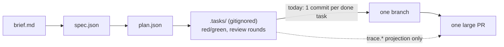
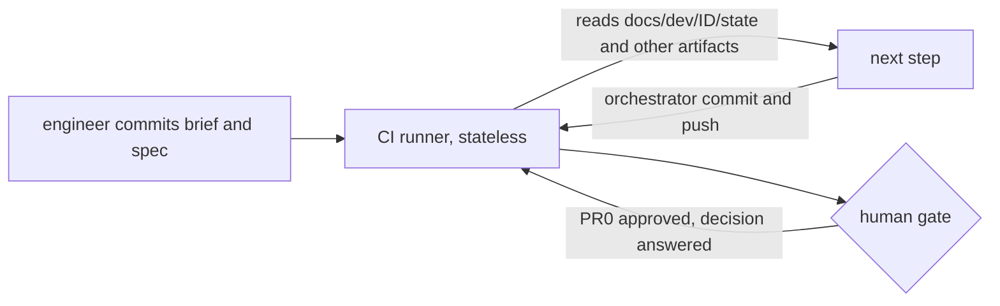
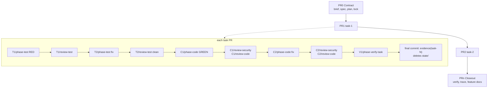

# Problem Brief: FEAT-ASDLC

> Authored by hand from the design discussion and the plan documents (not by `phase-align`). It is the first dog-food artifact of the evidence-stack process. Markers marked `confirmed` were decided by the owner; `proposed` markers still need confirmation. Confirmed by `cshirley` in session, 2026-05-17 (review round 1: depth, merge strategy, task naming, sizing scope, gating default, paths).

## Core Problem

ACCORD's agentic workflow suits small changes. For a new feature or greenfield solution, engineers cannot gain confidence in the code's lineage or in the process that produced it. Today one branch and one PR carry many features and concerns, and all of it must be merged at once. The red and green test runs, the adversarial review rounds, and the fix rounds live in `.tasks/` (gitignored), so git holds no evidence of them. Reviewers read one large diff plus a summary (`verify.md`).

Affected: engineers and reviewers who need to trust and navigate agent-built code, and agents that need to know what already exists. Cost of inaction: large unreviewable PRs, trust built on assertion instead of evidence, and new features that silently conflict with old ones.

## Stakeholders

- **Engineers using ACCORD** build features with the harness. They want small reviewable PRs and visible proof of the red, green and review process.
- **Reviewers** want the right information at the right time, without PR noise.
- **AI agents** (phase and review agents) need to discover existing features and check new work against them.
- **Harness maintainers** (`accord-core` owners) must keep layering: orchestration and domain logic in `accord-core`; `pi-accord`, `accord-cli`, `accord-mcp` as thin adapters.
- **Sign-off**: repository owner (`cshirley`).

## Current State

Today a work item is one branch and one PR, and the unit of commit is the task. The harness makes one commit per task that reaches `done` (`orchestration.commit.on_task_done`) and one closeout commit. Transient state lives in `.tasks/` (gitignored). Committed artifacts live in `docs/dev/<ID>/`, keyed by ticket. They are called immutable after their phase, but nothing enforces it. There is no capability-keyed record of what the system does, so a new change cannot be checked against older features.

Code references: `packages/accord-core/src/orchestration/policy.ts` (commit policy), `okf/references/artifacts-and-state.md` (artifact layout), `okf/references/orchestration-policy.md`.

## Desired Outcome

- **Engineer view**: a feature arrives as a stack of small PRs, each one concern. Commits show red tests, then green code, then review findings, then fixes. A reviewer can open any PR and see why it exists, what it proves, and how it was reviewed.
- **Business view**: confidence in agent-built code comes from evidence in git, not trust. Greenfield work becomes tractable.
- **Agent view**: a discoverable record of existing features, used to check new work for overlap and regressions.
- **Contract**: brief, spec and plan are locked as the first PR of the stack.

## Security & Data

State and evidence will enter git history, so they carry a leak risk. Raw return packets can contain prompts, transcripts, tokens and paths. Redaction is mandatory (`stack.state.redact`, default `true`), raw packets are excluded, and size is capped (`stack.state.max_bytes`). Under rebase or merge the snapshots stay in `main` history (squash drops them), so redaction must be correct the first time.

For the long-term CI mode, pushes need a GitHub App or PAT, because commits made with `GITHUB_TOKEN` do not trigger workflows. Secrets stay in CI configuration only.

## Infrastructure & Deployment

- Runs on Bun workspaces. Stack tooling uses the `gh` CLI first, behind a `StackProvider` port.
- Everything ships behind switches that default to off (`stack.enabled`, `knowledge.enabled`). Existing single-PR flow is unchanged.
- Trunk-based development: each task PR leaves `main` green and the feature unreachable until the final enable PR flips a flag. Rollback is to merge nothing further or revert the enable PR.
- Long-term target: CI-driven mode, triggered by committing `brief.md` and `spec.json` to a new branch. Builds on `packages/accord-ci` and the autopipeline.

## Scale & Performance

N/A for runtime load. The relevant limits are size limits: defaults (am-9, all configurable in `accord.json` under `stack.sizing`): 400 changed lines, 30 minimum, 10 files, 1.5x overrun (600 lines), and at most 6 open stacked PRs. The budget counts the net PR diff (`base...head`) of source and test files only; it excludes `docs/dev/<ID>/state/**`, `reviews/**` and `evidence/**`. A typical 1,500 to 2,500 line feature is 5 to 8 task PRs; total PRs are not capped. State snapshots are capped at 256 KiB per task. Feature index search must stay fast for a few hundred features (generated `index.json`).

## Constraints

- Layering rule from `AGENTS.md`: domain logic in `packages/accord-core`; adapters stay thin; Pi APIs never enter core.
- `manifest.json`, `registry.ts` and `schemas/` must stay aligned (`validate:assets`, `validate:schemas`).
- Use `pi-git` tools for git, PR and review; no manual `git commit` or `gh pr create`.
- Evidence commits are append-only: no amend, no force-push. Tasks must be planned independent, so each task PR branches from `main` and no restack is needed. Only a real `depends_on` chain forms a stack; there, retarget to `main` after the base merges, and merge bottom-up. The depth cap (default 6) limits *open* PRs in a chain; `computeStack` opens PR n+6 only after PR n merges.
- Existing `docs/dev/<ID>/` paths, `rehydrate`, trace and CI must keep working.
- Backward compatible: defaults leave current behaviour unchanged.

## Approach Direction

Git history is the evidence log. Full design: `docs/plans/evidence-stack-plan.md`. Summary:

1. **PR unit: one PR per concern.** Contract PR0 (brief, spec, plan, lock), then one PR per concern, then a closeout PR. A concern is usually one plan task. `computeStack(plan, config)` may merge small same-concern tasks into one PR, using size budgets and the plan dependency graph. The harness never splits a task into several PRs: an oversized task is a planning defect, and the plan agent re-plans it as smaller tasks (integer ids, no schema change). One PR must stay small and safe to merge to `main`. Sizing logic stays simple; if PR size drifts upward, rework it in a later ACCORD version using the planned-vs-actual data. PR count is `2 + packed task groups`. This replaces today's single PR.
2. **Commit unit: one commit per phase completion**, made only by the orchestrator (agents never commit), not per task. Every commit names its ref (loop and round), and this includes the adversarial reviews. A task PR reads: `T1/phase-test` (RED), `T1/review-test` (findings), `T2/phase-test` (answers), `T2/review-test` (clean), `C1/phase-code` (GREEN), `C1/review-security`, `C1/review-code`, `C2/phase-code` (answers both), `C2/review-security`, `C2/review-code`, `V1/phase-verify-task`, then the final `evidence(task-<N>)`. The refs (`T1`, `C2`, `V1`) are the harness's existing round refs, so each commit joins to the task file `log[]`. With `stack.enabled`, `review-security` gates on `critical` and `warning` findings (severity >= warning) inside the existing `C` loop, where it already runs after `phase-code` and before `review-code`; its fixes are the next `C` round, re-reviewed by `review-code`. With stack off it stays advisory: schema default of `orchestration.review_loop.review_security.severity_gate` is `advisory`, effective default `warn` when `stack.enabled` (plan section 5a). Findings are committed as their own commit before the next phase starts, so the orchestrator reads them back from the tree and a stateless CI runner never loses them. Review commits may touch only `docs/dev/<ID>/reviews/**` and `docs/dev/<ID>/state/**`, so a reviewer cannot alter what it reviews. Each commit has a human subject and body plus one machine-readable `Accord:` trailer of `key=value` pairs (ref, outcome, finding and test counts, tokens, model, cost) so `git log` and `awk` can report on the history and roll it up into the PR (plan section 3.2e). A guard rejects test edits in code-loop commits. This replaces today's one commit per task (`stack.commits: "phase"`; `"task"` keeps the old behaviour).
3. **Evidence asset**: the final commit of each PR, `evidence(task-<N>)` (for a merged PR, `evidence(task-<N>,<M>)`), writes one `docs/dev/<ID>/evidence/task-<N>.{md,json}` per task. The evidence asset survives any merge strategy, including squash; other guarantees depend on the strategy:

   | Guarantee | merge commit | rebase | squash |
   |---|---|---|---|
   | `evidence/task-<N>.{md,json}` in tree | yes | yes | yes |
   | typed commits and `Accord:` trailers in history | yes | yes | no |
   | state snapshots in `main` history | yes | yes | no |

   Use merge or rebase for task PRs when full audit matters.
4. **Tree state**: harness state is committed under `docs/dev/<ID>/state/task-<N>/` with each typed commit and deleted by the final evidence commit. This lets CI resume statelessly.
5. **Contract lock**: `contract.lock.json` (sha256) plus a guard; changes go through `contract-amend`.
6. **Feature knowledge**: keep `docs/dev/<ID>/` as the immutable change record; add a living, capability-keyed layer (`docs/features/`) with stable AC IDs and code anchors, updated by closeout PRs. Impact analysis, review invariants and a drift check cross-reference new against old.
7. **Reviewer surface**: one stack map comment and one generated PR brief per PR; three lenses (contract, net change, process audit); one `accord/evidence` status check; human notifications only at gates.
8. **Config**: top-level `stack` and `knowledge` keys in `accord.json`, in `accord-schema.json`.
9. **Scope**: `implement` and greenfield work items. `quick_fix` keeps one branch and one PR.

Delivery phases (plan section 6): 1 commit grammar and `accord evidence`; 2 contract PR0 and lock; 3 plan schema, `computeStack`, `gh` provider, evidence asset; 4 tree state; 5 trunk hardening; 6 feature knowledge; 7 CI-driven mode.

## Telemetry & Observability

The evidence asset, the stack map and the `accord/evidence` check are the production signals for reviewers. For the harness: record planned vs actual PR size in `trace.json` to tune sizing defaults, and keep the usage and cost rollup (`workflow-cost.*`) per PR. CI mode needs a visible run log per `<ID>` and a per-work-item cost cap.

## Open Questions

- Default for `knowledge.drift_check`: `warn` (set) or `block` once docs are maintained?
- Are the sizing defaults right (400 lines, 30 minimum, 10 files, 6 open PRs)? Tune from measured data.
- Confirm am-11 (merge-only packing; oversized tasks re-planned as smaller integer-id tasks) and how the planner detects oversized tasks before code exists.
- Exact phase-test guard for "fails for the right reason" (assertion failure vs compile error) per language.
- How are `decisions[]` answered in CI mode: PR comments, commits, or both?
- Granularity of a "feature" for `docs/features/` and when to split.
- Stack providers other than `gh` (`graphite`, `spr`, `git`): later.

## Alignment Markers

| ID | Claim | Status | Dimension |
|----|-------|--------|-----------|
| am-1 | Git history (typed red/green/review/fix commits) plus the per-PR evidence asset become the evidence log; history granularity depends on merge strategy | confirmed | approach |
| am-2 | Contract PR0 is not mandatory for `quick_fix`; only `implement` and greenfield | confirmed | scope |
| am-3 | Evidence is stored as an asset in the final commit of each PR, so squash-merge is safe | confirmed | approach |
| am-4 | `gh` is the first stack provider, configurable behind a port | confirmed | infrastructure |
| am-5 | Harness state persists in the tree (`docs/dev/<ID>/state/`), deleted by the final evidence commit | confirmed | approach |
| am-6 | Long-term target is CI-driven mode triggered by committing brief + spec | confirmed | infrastructure |
| am-7 | `docs/dev/<ID>/` stays as the change record; add a capability-keyed feature layer for discovery and cross-referencing | confirmed | approach |
| am-8 | `stack` and `knowledge` are top-level keys in `accord.json` | confirmed | constraints |
| am-9 | Default sizing budgets (400 lines, 30 minimum, 10 files, 6 open PRs, 1.5 overrun), net source+test diff, configurable in `accord.json` | proposed | scale |
| am-10 | `knowledge.drift_check` defaults to `warn` | proposed | approach |
| am-11 | PR count is computed by a deterministic merge algorithm (no task splitting; oversized tasks are re-planned as smaller tasks) and approved in PR0 | proposed | approach |
| am-12 | PR unit is one concern (usually one task); commit unit is one per phase completion with loop and round, including adversarial reviews, made only by the orchestrator | confirmed | approach |
| am-13 | `review-security` gates on critical and warning findings inside the existing `C` loop; its fixes are the next `C` round, re-reviewed by `review-code`; every review and fix is its own commit | confirmed | approach |
| am-14 | One `Accord:` trailer per commit, with cost, token, harness and model fields on every commit | confirmed | approach |

## Gathered Context

No tracker ticket was gathered. Source material: the design discussion in this session, `docs/plans/evidence-stack-plan.md`, `okf/architecture/evidence-stack.md`, `okf/references/stack-config.md`, `okf/references/knowledge-config.md`, and the schema keys added to `packages/accord-core/schemas/accord-schema.json`. Branch: `wt/FEAT-ASDLC`.
